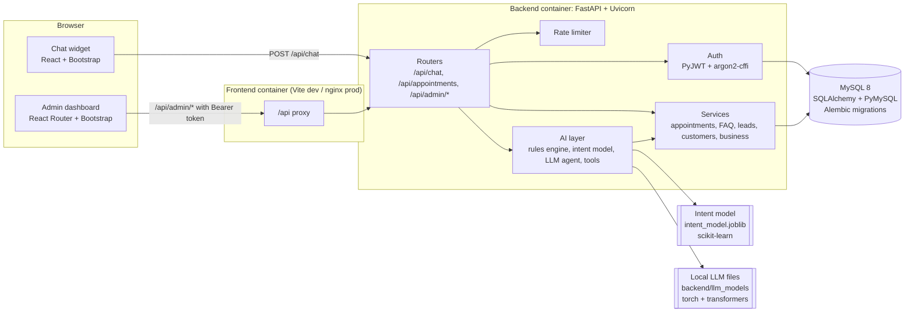
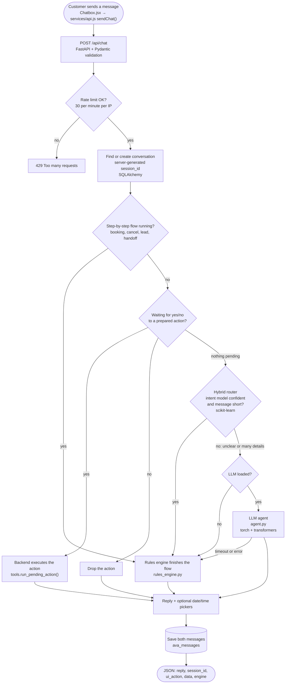
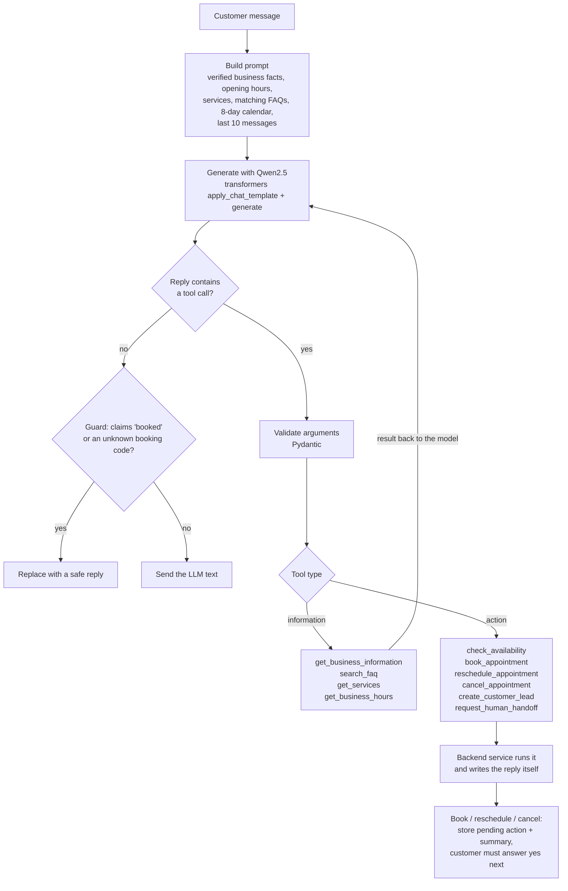
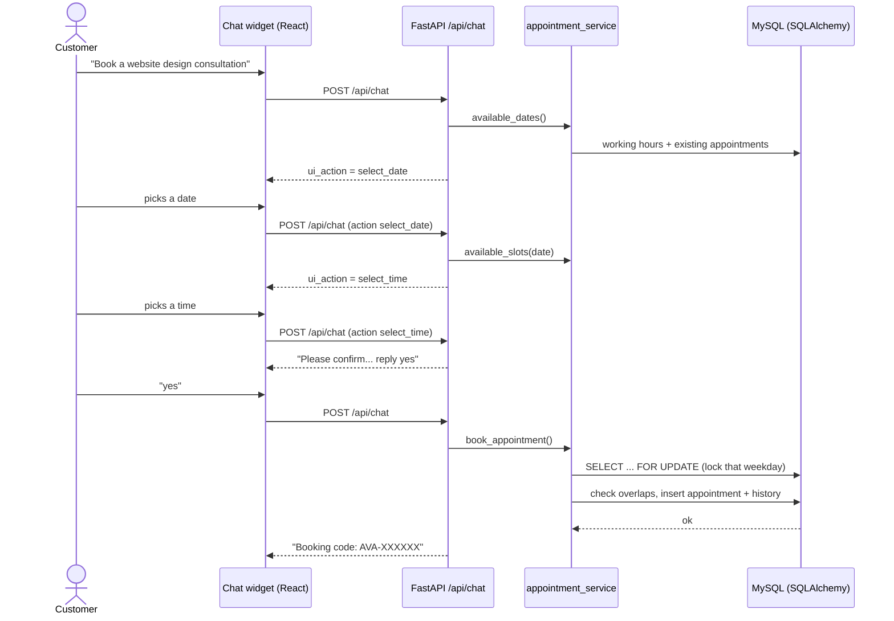
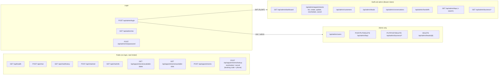
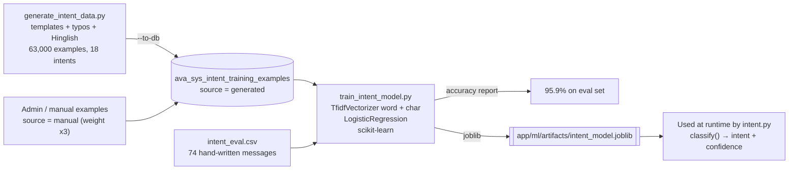
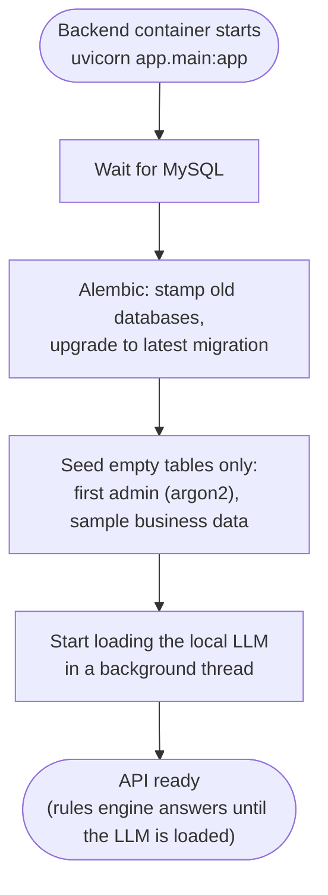
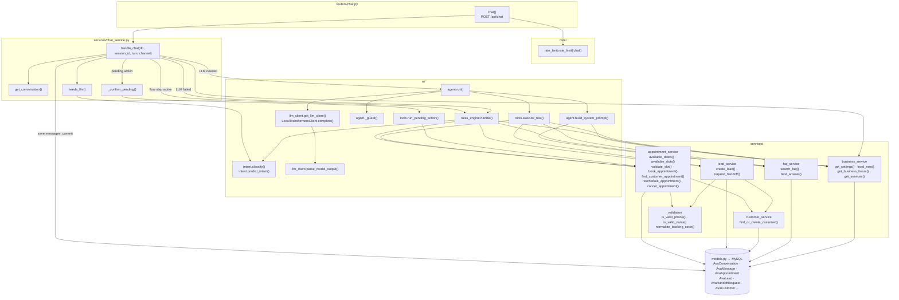
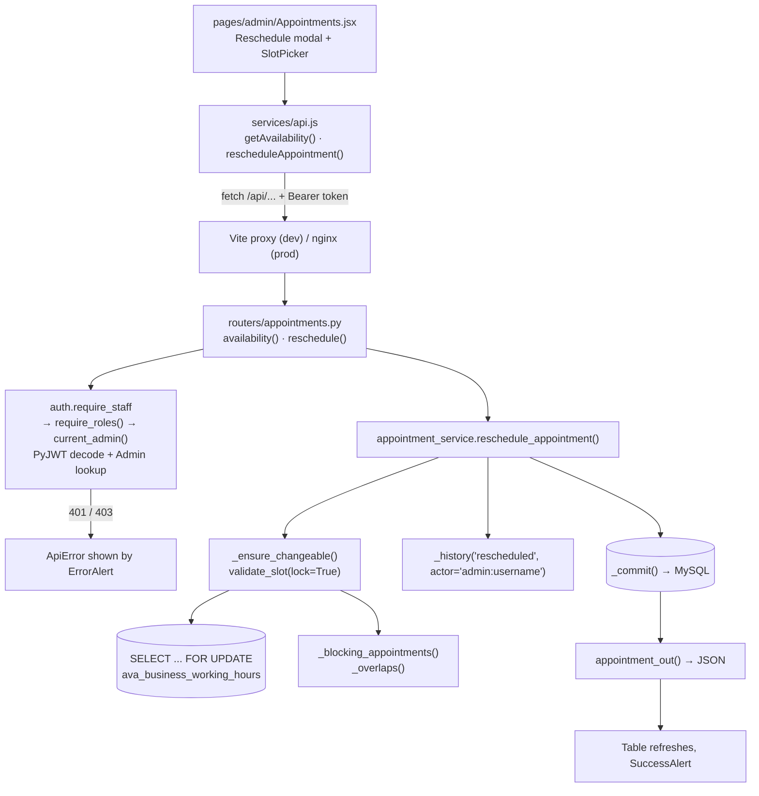
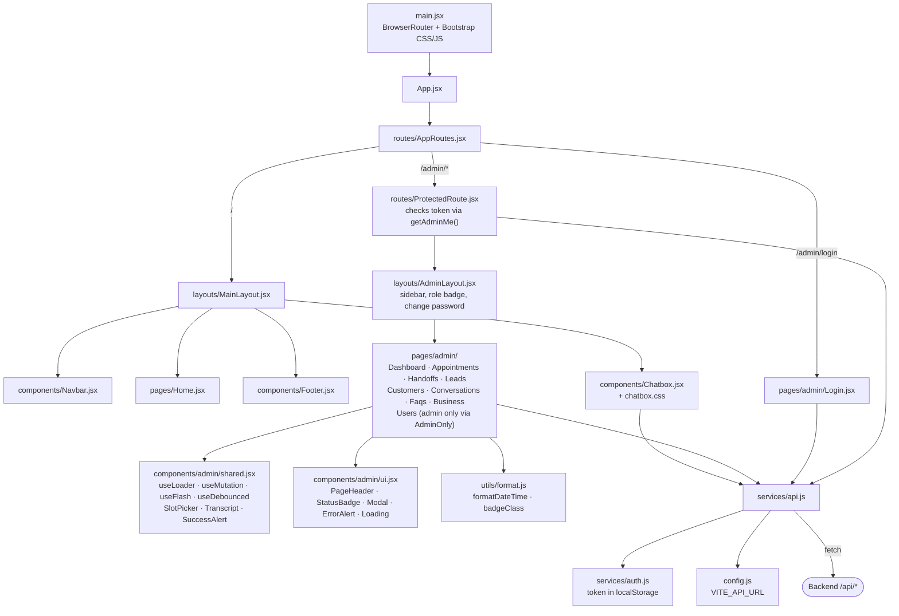

# Ava AI Receptionist — Libraries and Flowcharts

Every library is open source and runs inside this project. No paid API or external AI service is used.
Diagrams use Mermaid: they render on GitHub, and in VS Code with a Mermaid preview extension.

---

## 1. Libraries

### Backend: web API and database (`backend/requirements.txt`)

| Library | Version | Used for |
|---|---|---|
| fastapi | 0.162.0 | REST API, routing, request validation, Swagger docs (`/docs`) |
| uvicorn[standard] | 0.54.0 | ASGI server that runs FastAPI (hot reload in development) |
| pydantic | 2.14.3 | Validating request bodies and LLM tool arguments |
| sqlalchemy | 2.1.8 | ORM: models, queries, transactions, row locking |
| alembic | 1.20.1 | Database migrations (`backend/migrations/`) |
| pymysql | 1.2.3 | MySQL driver used by SQLAlchemy |
| cryptography | 50.0.2 | Needed by PyMySQL for MySQL 8 authentication |
| python-dotenv | 1.2.4 | Loads `backend/.env` |
| pyjwt | 2.15.1 | Admin login tokens (HS256, with expiry) |
| argon2-cffi | 25.1.0 | Argon2id password hashing |
| tzdata | 2026.6 | Time-zone data (needed when running on Windows) |

### Backend: machine learning (`backend/requirements.txt`)

| Library | Version | Used for |
|---|---|---|
| scikit-learn | 1.9.1 | Intent classifier (TF-IDF + LogisticRegression) and FAQ search (TF-IDF + cosine similarity) |
| joblib | 1.6.0 | Saving and loading the trained intent model (`intent_model.joblib`) |
| numpy, scipy | (installed by scikit-learn) | Maths behind scikit-learn |

### Backend: local LLM (`backend/requirements-llm.txt`)

| Library | Version | Used for |
|---|---|---|
| torch (CPU build) | 2.15.0 | Runs the neural network (installed from the PyTorch CPU index) |
| transformers | 5.22.2 | Loads Qwen2.5-Instruct, builds the chat prompt with tools, generates replies |
| accelerate | 1.15.0 | Memory-efficient model loading |
| huggingface_hub, tokenizers, safetensors | (installed by transformers) | One-time model download, tokenizer, weight files |

Model: **Qwen/Qwen2.5-0.5B-Instruct** (Apache-2.0), stored in `backend/llm_models/hub/`.

### Backend: tests (`backend/requirements-dev.txt`)

| Library | Version | Used for |
|---|---|---|
| pytest | 9.2.0 | Test runner (82 tests) |
| httpx | 0.28.1 | HTTP client used by FastAPI's TestClient |

### Frontend (`frontend/package.json`, installed versions)

| Library | Version | Used for |
|---|---|---|
| react, react-dom | 18.3.1 | User interface |
| react-router-dom | 6.30.6 | Pages and routes (`/`, `/admin/...`) |
| bootstrap | 5.3.8 | Layout, styling, responsive design |
| bootstrap-icons | 1.13.1 | Icons |
| vite | 5.4.21 | Dev server, `/api` proxy, production build |
| @vitejs/plugin-react | 4.7.0 | JSX support in Vite |

### Infrastructure (Docker images)

| Image | Used for |
|---|---|
| python:3.13-slim | Backend container |
| node:22-alpine | Frontend dev server and build |
| nginx:1.27-alpine | Production: serves the built frontend, proxies `/api` |
| mysql:8.0 | Database |
| phpmyadmin:latest | Database admin tool (development) |

---

## 2. System overview

---

## 3. Chat message flow (`POST /api/chat`)

---

## 4. LLM agent and tools

---

## 5. Appointment booking (with double-booking protection)

---

## 6. API map

---

## 7. Intent model training

---

## 8. Startup sequence

---

## 9. Code flowchart: one chat message through the backend files

File → function. Arrows mean "calls".

---

## 10. Code flowchart: an admin request (example: reschedule an appointment)

---

## 11. Code flowchart: frontend structure

